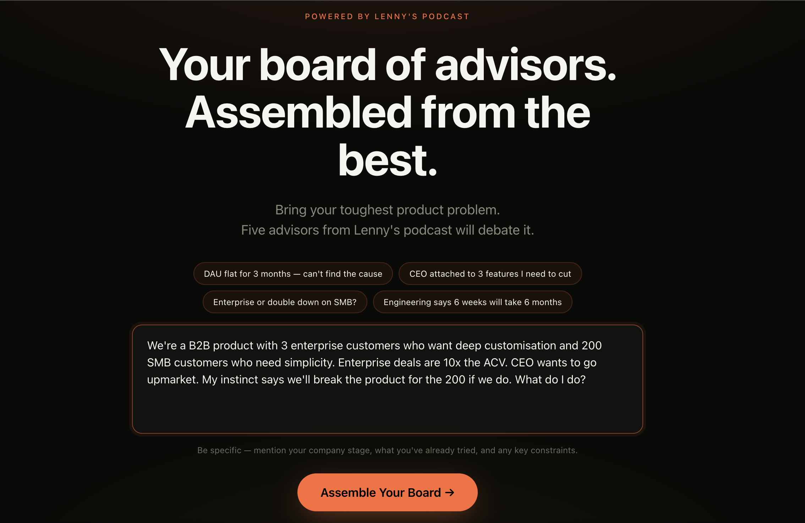
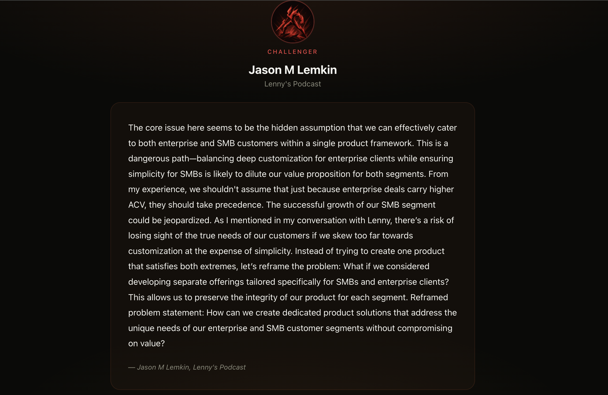
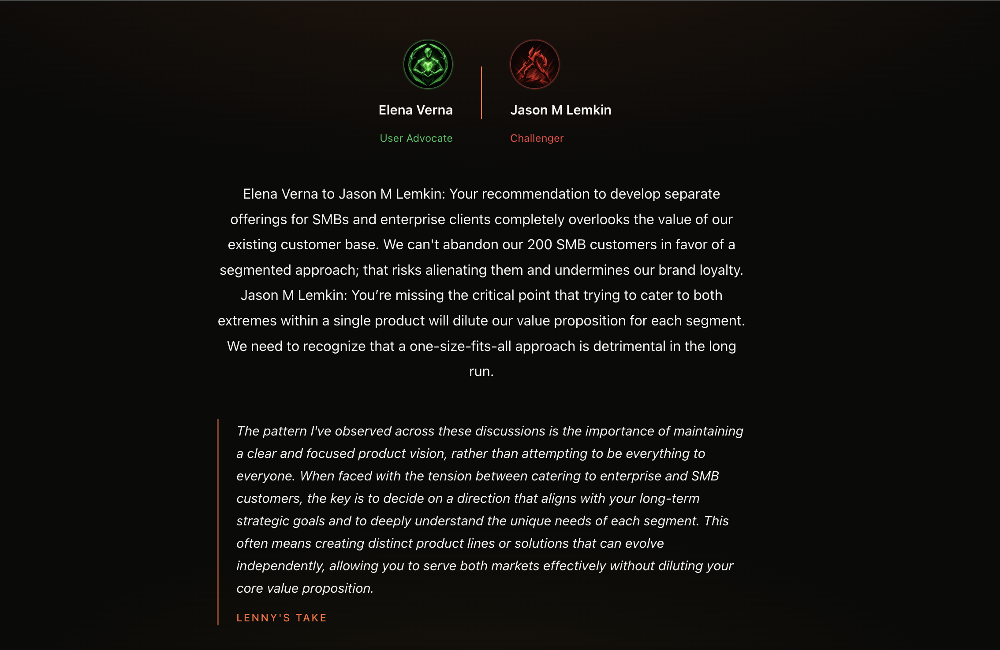
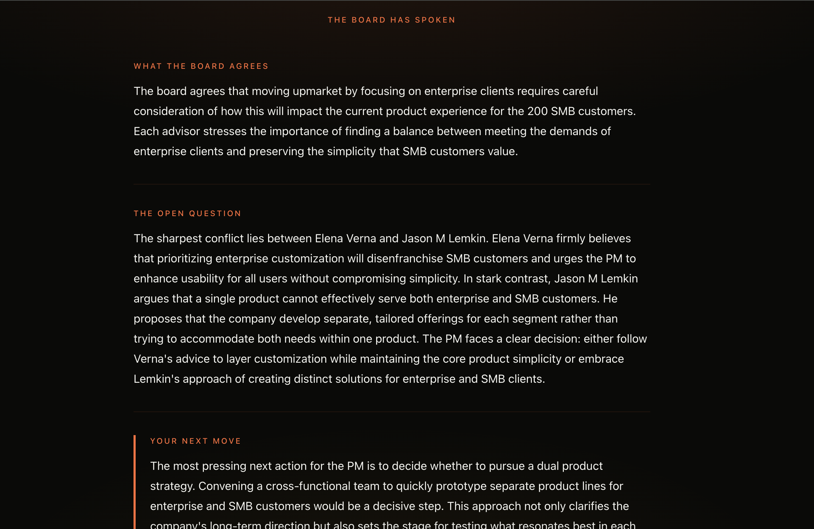
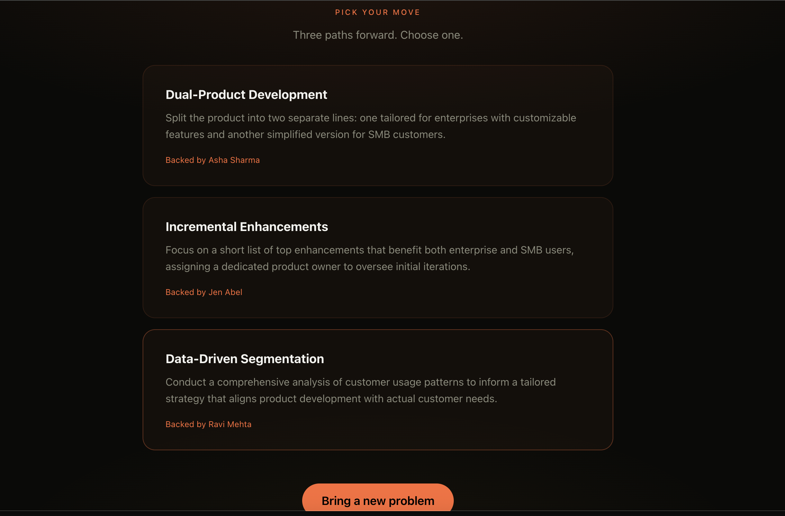

# Lenny's Board Room

Assemble a board of Lenny's podcast guests to debate your toughest PM problem.

**[Try it live](https://lennys-board-room.replit.app)** · **[Watch the demo](https://www.youtube.com/watch?v=QShHM6LvSwY)**

---

## Screenshots

| Landing | Board Player |
|---|---|
|  |  |

| Debate | Synthesis | Pick Your Move |
|---|---|---|
|  |  |  |

---

## What It Does

You bring a real PM problem. The system pulls the most relevant guests from Lenny Rachitsky's podcast archive, assigns each a distinct advisory role, and runs an 8-step pipeline. You leave with three actionable bets, each backed by a specific advisor and a clear tradeoff.

Built for the [Lenny x Replit Buildathon](https://lennysbuildathon.replit.app), May 2026.

---

## The Pipeline

| Step | What happens |
|---|---|
| 1. Analyze | Problem classified, 3 to 5 search queries generated |
| 2. Retrieve | Queries embedded, top-10 vector search per query in Supabase pgvector |
| 3. Select board | 5 guests assembled from retrieved chunks, each assigned a role |
| 4. Generate responses | All 5 board members respond in parallel, grounded in their transcript chunk |
| 5. Debate | The two most incompatible members argue directly in first-person speech |
| 6. Synthesis | 3-paragraph synthesis: agreement, tension, one next action |
| 7. Lenny's insight | Cross-guest pattern in Lenny's voice |
| 8. Pick your move | 3 actionable bets: bold structural move, execution-first move, reframe move |

Steps 5, 6, and 7 run in parallel. Total: ~28 seconds end to end.

---

## The Board

| Role | What they do |
|---|---|
| The Challenger | Reframes the problem, surfaces hidden assumptions |
| The Operator | Execution focus — how do you actually do this |
| The Visionary | 10x thinking, the opportunity being missed |
| The User Advocate | Brings it back to the user always |
| The Data Oracle | Evidence-first, identifies what is being measured wrong |

---

## Stack

- **Frontend:** React (Vite + Tailwind)
- **Backend:** FastAPI on Replit
- **Vector DB:** Supabase pgvector
- **Embeddings:** text-embedding-3-small (1536 dimensions)
- **LLMs:** gpt-4o-mini for board responses and debate · gpt-4o for synthesis, Lenny's insight, and Pick Your Move
- **Data:** 2,178 chunks from 50 podcast transcripts + 10 Lenny newsletters

---

## Performance

| Metric | Value |
|---|---|
| Total latency | ~28 seconds |
| Cost per session | ~$0.022 |
| Retrieval | 4 parallel queries, deduplicated by guest |
| Board responses | 5 parallel LLM calls |
| Bottleneck | Board selection (select_board): 13s, 46% of total flow |

---

## Key Design Decisions

**gpt-4o-mini vs gpt-4o split** — Mini handles structured extraction tasks (analysis, board selection, 5 parallel responses, debate). gpt-4o handles the 3 outputs the PM actually acts on: synthesis, Lenny's insight, and Pick Your Move. One call per request justifies the higher cost.

**Supabase over Pinecone** — The product needed a relational database for chunk metadata anyway. Supabase provides pgvector and Postgres in one service, removing a separate vector store.

**Observability from day one** — Every LLM call logs task name, model, token counts, and cost. Per-request call log returned in the API response. This surfaced the select_board bottleneck before any optimization work started.

---

Built by [Saurabh Sudhir](https://saurabhsudhir.vercel.app) · Senior PM focused on AI products.
